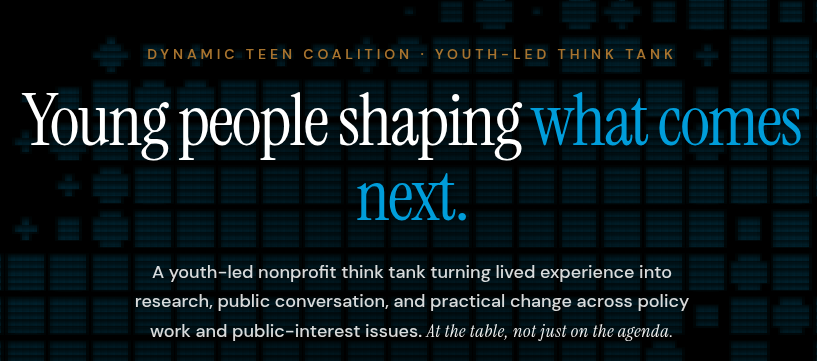

# Dynamic Teen Coalition website
This repo is for the DTC website, supporting a youth-led think tank empowering the youth.

## Installing & Running
The tool was made primarily for use w/ Next.js static rendering. **You will need npm / node!**

1. Copy the repo, and cd to it `   git clone https://github.com/Null-Austin/dtc-website && cd dtc-website` 
2. Install the requirements `npm i`
3. Finally, either build or preview the website `npm run build` : `npm run dev`

## Contributing
For information on contributing, please check out [CONTRIBUTING.md](CONTRIBUTING.md)

## Licensing
We use MIT licensing, for more information check out [LICENSE.md](LICENSE.md)

## Credits
Credits can always be found @ [contributors.txt](contributors.txt): if you are a contributor, feel free to append your name at the bottom to be showcased in `/human.txt`